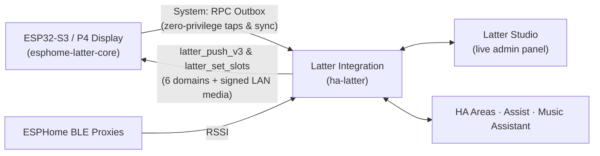

# Latter Core

Turnkey firmware and a compiled C++20 UI/OS for five off-the-shelf Waveshare ESP32-S3 and ESP32-P4 touch displays, plus a trait-driven SDK for building your own display or headless companion node. Built on [ESPHome](https://esphome.io) and paired with the **[Latter](https://github.com/slampton/ha-latter)** Home Assistant integration, every device adapts to the Area it is in at runtime—with zero hardcoded entity IDs and zero YAML reflashing.

[](https://github.com/slampton/esphome-latter-core/actions/workflows/validate.yml)
[](https://github.com/slampton/esphome-latter-core/releases)
[](LICENSE)

<!-- MEDIA: docs/media/hero.jpg — all five devices on a desk, each showing a different app (Home, Music, Area Control, Time, Sky & Weather). -->

| Repository | Runs on | Responsibility |
| :--- | :--- | :--- |
| **[ha-latter](https://github.com/slampton/ha-latter)** | Home Assistant | Integration and **Latter Studio**: live entity mapping, BLE Area presence, signed ESP32 image/audio proxy, and automations. **Start there** if you're setting up a home. |
| **esphome-latter-core** *(this repo)* | ESP32-S3 / ESP32-P4 | Compiled C++20 firmware (`latter_core`, `latter_ui`, `latter_beacon`), [Web Installer](https://slampton.github.io/esphome-latter-core/), and hardware/UI SDK. |

---

## Supported Hardware & 3-Minute Setup

<!-- MEDIA: docs/media/device-<slug>.jpg — row of front-view thumbnails for Pocket, Mobile, Wrist, Remote, and Desk. -->

| Device | Waveshare Hardware | Display | Best For |
| :--- | :--- | :--- | :--- |
| **Pocket Assistant** | [ESP32-S3-Touch-AMOLED-1.75C][ws-175c] | 1.75" round AMOLED, 466×466 | Carrying room to room; voice, music, and quick Area controls |
| **Mobile Assistant** | [ESP32-S3-Touch-AMOLED-2.16][ws-216] | 2.16" square AMOLED, 480×480 | Handheld with extra room for album art, sliders, and browsing |
| **Wrist Assist** | [ESP32-S3-Touch-AMOLED-2.06][ws-206] | 2.06" watch AMOLED, 410×502 | Wearable timers, alarms, Assist, and per-person BLE presence |
| **Remote Assistant** | [ESP32-P4-WIFI6-Touch-LCD-3.5][ws-p4-35] | 3.5" IPS, 320×480 | Fast P4 couch remote for TVs, AV receivers, and whole-home control |
| **Desk Assistant** | [ESP32-P4-86-Panel-ETH-2RO / WIFI6-Touch-LCD-4B][ws-p4-desk] | 4.0" IPS, 720×720 | Always-on desk or wall panel with sharp HD typography and wake word |

<sub>Hardware links above are Waveshare affiliate links—buying through them supports Latter at no extra cost to you. (On the Desk Assistant page, both `ESP32-P4-86-Panel-ETH-2RO` and `ESP32-P4-WIFI6-Touch-LCD-4B` share the same mainboard and are validated.)</sub>

All five boards run the **exact same firmware and universal GUI**. Each board file (~80–160 lines of YAML) declares only pins, buses, and `LATTER_*` capability traits; layout, slot counts, touch hit targets, and power policy adapt at compile time. → [Hardware specs & pin maps](docs/hardware.md)

### Quickstart
1. **Pick a board** from the table above and connect it to your computer with a USB-C data cable.
2. **Flash in Chrome or Edge** using the **[Latter Web Installer](https://slampton.github.io/esphome-latter-core/)** (~2 minutes, including Wi-Fi setup over USB via Improv Serial), or compile in ESPHome Device Builder. → [Flashing guide](docs/flashing.md)
3. **Adopt in Home Assistant**: add the discovered ESPHome device (leave *"Allow the device to perform Home Assistant actions"* **off**), install **[Latter (`ha-latter`)](https://github.com/slampton/ha-latter)** via HACS, accept **Discovered: Latter**, and open **Latter Studio** in the sidebar. → [Getting started walkthrough](https://github.com/slampton/ha-latter/blob/main/docs/getting-started.md)

---

## What Runs on the Device

<!-- MEDIA: docs/media/apps-tour.gif — swiping through Home → Time → Music → Area Control → Sky & Weather on Mobile Assistant. -->

| App | Highlights |
| :--- | :--- |
| **Home** | Digital clock, roaming Area badge (`area_icon`), live weather sky or `720p` wallpaper, adaptive `0/1/2`-row **Activity Card** (calls, timers, alarms, stopwatch, music queue, next event), and customizable app dock (or locked single-app kiosk mode) |
| **Clock** | Three zero-chrome SDF clock faces (**Minimal Digital**, **Modern Analog** on round panels, **Hybrid Digital**) with smooth 20 FPS sweep on USB and for 15 s after wake on battery |
| **Time** | 4-tab app: **Clock** (optional custom local label, DST/zone info, UTC, and up to 4 custom-city World Clocks), **Timers** (3 local slots + Assist timers), **Alarms** (3 recurring NVS slots synced 2-way with Studio), and **Stopwatch** (lap splits) |
| **Music** | Now Playing with full-bleed art, seek/skip, speaker picker, seamless Music Assistant queue transfer, speaker grouping, library browser, lyrics, and artist/album bios |
| **Area Control** | Fill-slider cards scoped to the device's current Area (Scenes, Lights with HSV wheel & 2700–6500 K slider, Blinds & Curtains, Fans, Switches, Climate, Media) |
| **Home Hub** | 6-tab whole-home deck: **Alarm**, **Cameras** (up to 10 snapshots + doorbell listen/reply/unlock), **Intercom**, **Thermostat**, **Entry & Garage**, and **Vacuum**, with separate HA Alarm PIN vs. Perimeter Security PIN prompts |
| **Remote** | Tactile D-pad, transport, volume, and power for up to 10 TVs, streaming boxes, or AV receivers |
| **Sky & Weather** | Current conditions, 5-day forecast, solar arc, and real-albedo 3D lunar phase over animated clouds, fog, rain, snow, plasma-bolt storms, tumbling leaves, and night meteors |
| **Tools** | Calculator, Calendar (agenda, quick-add, zoomable OpenStreetMap event pins), Dice, Coin Flip, Flashlight, plus Bubble Level (IMU boards) and Analog Chronograph (round displays)—5 to 7 tools per board |
| **Games** | Marbles, Archery, Bricks, Chomp, 2048, and Memory Match (tilt-steered with touch fallback on IMU boards; touch-steered elsewhere) |
| **Voice** | On-device [microWakeWord](https://github.com/kahrendt/microWakeWord) (*Okay Nabu*, *Hey Jarvis*, *Hey Mycroft*, *Alexa*, *Hey Luna*) into Home Assistant Assist with 5 reactive visual overlays |

→ [Using your device](docs/using-your-device.md)

---

## Under the Hood



If you're evaluating the firmware or building on the SDK, these are the engineering choices doing the heavy lifting—each linked directly to source:

- **`2px` Dirty-Band Compositor, Co-Located `FrameHitTable` & 2-Tier Neutral Glass.** Localized updates (clock ticks, timers, progress bars, sliders) align dirty spans `[y0, y1]` to even-to-odd rows across full width `0 .. W − 1`, preserving `MipiSpiBuffer`'s contiguous `stride == W` zero-copy DMA fast path while cutting SPI/QSPI pixel traffic 5–12×. Row-major RGB565 scanlines group identical pixel runs and dim scrims in 1/256 with ordered Bayer dithering (never lossy bitmask shifts). Interactive controls use a backdrop-invariant `37.5–45.3%` frosted-glass template (`GlassVariant::Clear`, with `ReadableDark` reserved for high-opacity opt-in) and register exact bounds into `FrameHitTable` as they draw, backed by **7,447 Material Design Icons** compiled into LZSS Bezier bytecode (`4×` AA rasterizer). → [`ui_compositor.h`](include/ui_compositor.h), [`ui_gfx.h`](include/ui_gfx.h), [`ui_hit_table.h`](include/ui_hit_table.h), [`ui_mdi.h`](include/ui_mdi.h)
- **Procedural `WeatherSkyEngine` & Zero-Trig Hot Path.** Static atmospheric gradients, star domes, cumulus canopies, and a 139×139 real lunar albedo texture shaded with a 3D spherical terminator render once into a PSRAM `SkyBaseCache`; stateless rain, snow, and plasma-corona lightning composite in Q8 fixed-point on top (animating continuously on USB, or for 35 s after wake on battery before an 800 ms fade to 0 FPS). Trig uses a 60-entry interpolated LUT and round bezel clipping uses a 466-entry flash chord table—no `sinf` or `sqrtf` in per-pixel loops. → [`page_weather.cpp`](components/latter_ui/page_weather.cpp), [`ui_types.h`](include/ui_types.h)
- **Zero-Privilege Bound RPC & Sleep-Safe 50-Preference NVS Sync.** Outbound taps emit compact chunked envelopes on `System: RPC Outbox` (`latter_rpc::emit`) and inbound state arrives across **6 Protocol v3 domains** via `latter_push_v3` and `latter_set_slots`—requiring neither `allow_service_calls` nor `device_slug` substitutions. Replacing ~45 ESPHome YAML setting entities with a single versioned NVS struct (`PersistedDevicePrefs` v6 + cold-boot `HibernateSnapshot` v2) reclaims ESP32-S3 internal SRAM and reconciles offline edits on `device_hello`. Separate `alarm_caps` flags pass Home Assistant alarm codes straight through while Perimeter Security PINs guard locks and garage covers. → [`latter_rpc.h`](include/latter_rpc.h), [`latter_state.h`](include/latter_state.h), [`DEVICE_CONTRACT.md`](DEVICE_CONTRACT.md)
- **Full-Duplex 48 kHz Audio & Synchronous Voice Preemption.** Every board runs DAC and ADC together on one shared-clock 48 kHz I2S bus (with `latter_mic` resampling mic input to 16 kHz for wake word and Assist), eliminating I2S teardown clicks and bus handoffs. `AudioPathArbitrator` and `AudioSessionController` pause media and drain mixer buffers synchronously when a voice turn starts, keep wake-word listening muted over local playback (until on-device AEC lands), and never resume music over a ringing alarm or timer. → [`audio_router.h`](include/audio_router.h), [`audio_session.cpp`](components/latter_core/audio_session.cpp), [`audio_voice.yaml`](modules/audio_voice.yaml)
- **`5–8 mA` S3 Light Sleep, `< 1 ms` Raw-HCI Beacon Pause & Native IRAM P4 DSI.** ESP32-S3 battery boards enter automatic FreeRTOS tickless light sleep in `WIFI_PS_MAX_MODEM` (`1,000 ms` quiet loop, `250 ms` with touch wake, `-65 dBm` weak-link hold; `~5–8 mA` on home Wi-Fi, `~2–4 mA` off-site with exponential scan backoff). `latter_beacon` speaks raw HCI over VHCI (S3) or `esp_hosted` (P4) with zero Bluedroid/NimBLE RAM overhead and pauses advertising in `< 1 ms` during battery screen-off. Wrist and Mobile restore UTC wall time at cold boot from onboard PCF85063 RTCs before Wi-Fi connects. ESP32-P4 boards keep fixed `CPLL` + `200 MHz` PSRAM (avoiding 40 MHz XTAL DFS SDIO stalls) and pair ESPHome `2026.11.0+` native IRAM MIPI-DSI callbacks with IRAM GDMA ISRs so the 720×720 panel stays tear-free during OTA flash erases. → [`power_pm.cpp`](components/latter_core/power_pm.cpp), [`latter_beacon.cpp`](components/latter_beacon/latter_beacon.cpp), [`power_battery.cpp`](components/latter_core/power_battery.cpp), [`waveshare_p4_86_panel.yaml`](boards/waveshare_p4_86_panel.yaml)
- **Adaptive Frame Cadence & `[PROF:*]` Flight Recorder.** `FrameCadenceController` coalesces same-loop redraws into 18 ms frames on P4 and 26 ms on S3, steps ambient screensavers at `16.7 FPS` (`12.5 FPS` during audio), and pairs with the runtime **System: Telemetry Profiler** switch and `RTC_NOINIT` `PmCrumb` crash forensics. → [`ui_compositor.h`](include/ui_compositor.h), [`latter_prof.h`](include/latter_prof.h)

---

## Build on Latter Core

The firmware is split into clean layers backed by three compiled C++20 PlatformIO components (`latter_core`, `latter_ui`, `latter_beacon`), so you can swap the board HAL, replace the GUI, or run a headless node without forking the OS:

```text
components/  Compiled C++20 SDK: latter_core (HAL, Protocol v3, RPC, audio/power controllers), latter_ui, latter_beacon
boards/      Board HAL + facts ledger: pins, buses, codecs, PMU, IMU, RTC, and LATTER_* traits
modules/     Core YAML: base & system_core, power_manager, audio_voice, display_pipeline, timers_and_fetchers
guis/        Universal GUI: display lambda + UiTouchEngine / FrameHitTable (replaceable; base.yaml for headless)
devices/     Turnkey product configs combining one board HAL with latter_display_firmware.yaml
```

| Guide | When to read it |
| :--- | :--- |
| **[Architecture](docs/architecture.md)** | How the 3 C++20 components, 13 YAML modules, and S3/P4 power policies fit together |
| **[Device protocol](docs/device-protocol.md)** & **[Contract](DEVICE_CONTRACT.md)** | How `ha-latter` discovers, pushes 6 Protocol v3 domains to, and receives RPCs from a device |
| **[Building a GUI](docs/building-a-gui.md)** | Writing a custom touch or rotary interface on top of `latter_core` |
| **[Device UI design guide](docs/device-ui-design.md)** | Design tokens, 2-tier glass, layout math, `FrameHitTable`, and rendering budgets |
| **[Porting hardware](docs/porting-hardware.md)** | Bringing up a new ESP32-S3 or ESP32-P4 board with `boards/facts/*.json` and `tools/new_board.py` |

---

## Project Status

Version **3.0.0** — built, bench-validated, and maintained across all five flagship devices above.

| Area | Status |
| :--- | :--- |
| Five flagship devices, universal GUI, 6-domain Protocol v3 sync, full-duplex audio, voice, and power | **Stable** |
| Doorbell listen & push-to-talk reply | **Experimental**: camera audio streams to the device with FFmpeg noise reduction; push-to-talk transcribes speech and speaks it at the door via TTS (full-duplex calls with on-device AEC planned) |

**CI & Release Discipline:**
- Every push to `dev` runs `tools/verify_core.py`, `tools/gen_protocol.py --check`, `tools/check_protocol_usage.py`, `tools/check_boards.py --release --check-docs`, `tools/new_board.py --bringup --check`, `tools/gen_sounds.py --check`, `tools/gen_mdi_pack.py --check`, C++20 host unit tests, `esphome config` across examples/probes/devices, and **full 5-device firmware compilation** before CI fast-forwards `main`.
- Bugs and feature requests: [GitHub Issues](https://github.com/slampton/esphome-latter-core/issues).

## Documentation

| | |
| :--- | :--- |
| **Use** | [Hardware](docs/hardware.md) · [Flashing](docs/flashing.md) · [Using your device](docs/using-your-device.md) |
| **Build** | [Architecture](docs/architecture.md) · [Device protocol](docs/device-protocol.md) · [Protocol v3 contract](DEVICE_CONTRACT.md) · [Building a GUI](docs/building-a-gui.md) · [Device UI design](docs/device-ui-design.md) · [Porting hardware](docs/porting-hardware.md) |

## Credits & Support

Built on [ESPHome](https://esphome.io), [microWakeWord](https://github.com/kahrendt/microWakeWord), [Music Assistant](https://music-assistant.io) & Sendspin, [Pictogrammers Material Design Icons](https://pictogrammers.com/library/mdi/), and [ESP Web Tools](https://esphome.github.io/esp-web-tools/). The *Hey Luna* wake word model is by [Daniel Reimer](https://github.com/dreimer1986/micro-wake-word-models) ([`models/`](models/)).

Latter is free and open source ([Apache License 2.0](LICENSE)), designed, brought up on physical hardware, and maintained by Sean Lampton (AI coding assistants are used for drafting code and docs; architecture, schematic verification, and hardware testing are done by hand). Hardware bring-up costs real money—if Latter is useful to you:
- [GitHub Sponsors](https://github.com/sponsors/slampton) · [Buy Me a Coffee](https://www.buymeacoffee.com/slampton)

[ws-175c]: https://www.waveshare.com/esp32-s3-touch-amoled-1.75c.htm?&aff_id=140049
[ws-216]: https://www.waveshare.com/esp32-s3-touch-amoled-2.16.htm?&aff_id=140049
[ws-206]: https://www.waveshare.com/esp32-s3-touch-amoled-2.06.htm?&aff_id=140049
[ws-p4-35]: https://www.waveshare.com/esp32-p4-wifi6-touch-lcd-3.5.htm?&aff_id=140049
[ws-p4-desk]: https://www.waveshare.com/esp32-p4-wifi6-touch-lcd-4b.htm?&aff_id=140049
