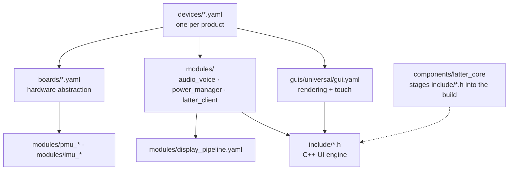

# Architecture

## Layers



A device config is just a list of packages:

```yaml
# devices/pocket-assistant.yaml (abridged)
external_components:
  - source: { type: git, url: https://github.com/slampton/esphome-latter-core, ref: main }
    components: [latter_core]
    refresh: 0s

latter_core:

packages:
  hal:                !include ../boards/waveshare_s3_175c.yaml
  latter_audio_voice: !include ../modules/audio_voice.yaml
  latter_power:       !include ../modules/power_manager.yaml
  latter_client:      !include ../modules/latter_client.yaml
  latter_gui:         !include ../guis/universal/gui.yaml
```

Device files also define the parts that differ per product: the `wifi` id, the `ble_ctrl` presence beacon (`latter_beacon`: raw HCI with no host stack, over VHCI on an on-chip controller or over esp_hosted on the P4) and its iBeacon minor, the update source, and default substitutions (power profile, clock face, font sizes).

---

## Directory map

### `boards/`: hardware abstraction (one file per board)
A board file defines:
- **Hardware:** the display, touchscreen, I2C/SPI buses, I2S, and audio codecs.
- **Modules:** which PMU and IMU modules to include.
- **Build settings:** the `LATTER_*` capability flags and sdkconfig options.
- **HAL scripts:** the scripts the core calls, such as `hal_route_i2s_to_spk` and `hal_enter_hardware_hibernate`.

→ [Porting hardware](porting-hardware.md)

### `modules/`: the core

| File | Role |
| :--- | :--- |
| `latter_client.yaml` | The Latter protocol client. Covers boot sequence, API actions, every Home Assistant subscription, global state, user-facing selects, switches, and numbers, and the scripts that call `latter.*` services. Also the input router (`ui_input_event`), theme and brightness, and OTA hooks. Includes `display_pipeline.yaml`. |
| `display_pipeline.yaml` | `http_request`, Sendspin album art, 3 `online_image` slots (artwork, wallpaper, camera; JPEG decoded to RGB565 at screen size), backlight output with a gamma curve, and the Display light |
| `audio_voice.yaml` | Mixer (no on-device resampling: every source arrives at the board's output rate), Sendspin media source, media player, micro_wake_word, voice_assistant, the internal sound player for alarms, chimes and game sounds (WAVs rendered per rate by `tools/gen_sounds.py`), plus the voice and TTS lifecycle scripts |
| `power_manager.yaml` | The power state machine (active, screensaver, screen off, hibernate), sleep and wake selects, 1 s and 50 ms supervisors, hibernate sequencing, and script `apply_power_policy`, the single owner of every power actuator (Wi-Fi modem sleep, the BLE beacon, the IMU mode, tick gating, battery polling, the light-sleep awake lock and wake pins) |
| `pmu_axp2101.yaml` / `pmu_none.yaml` | Battery, USB, and crown-button handling, or stubs for mains-powered boards |
| `imu_qmi8658.yaml` / `imu_none.yaml` | Accelerometer, tilt, and shake detection, or stubs that return constants |
| `base.yaml` | Minimal identity, time sync, `latter_ping`, and a static hardware manifest, for headless nodes |
| `area_control.yaml` | Area subscription plus area-action scripts, for headless nodes |
| `display_ui.yaml` | Convenience umbrella that bundles `latter_client.yaml` and the universal GUI. Used by `examples/custom_display_template.yaml`. |

### `guis/universal/gui.yaml`: the GUI
Fonts, the color palette, the `display:` render lambda (an `!extend` of `disp1`), and touch gesture handling (an `!extend` of `touch_screen`). It defines no API. Everything it needs comes from `latter_client.yaml`. → [Building a GUI](building-a-gui.md)

### `include/`: C++ UI engine
| Header | Contents |
| :--- | :--- |
| `ui_core.h` | `LATTER_*` defaults, screen constants, scaling helpers, page IDs, trig and chord lookup tables, drawing primitives, the album-art blitter, the redraw scheduler, the flight recorder |
| `ui_layout.h` | `UiLayout` geometry and hit-testing, hardware manifest builder, backlight PWM, Wi-Fi power save, dock and mode-bar animation, focus engine, OTA helpers, the P4 DSI IRAM wrapper |
| `ui_clock_home.h` | Clock faces, home page, app dock |
| `ui_music.h` | Music pages |
| `ui_area_home_hub.h` | Area Control and Whole-Home Hub |
| `ui_remote.h` | Remote |
| `ui_weather_sky.h` | Weather page and animated sky |
| `ui_tools.h` | Tools, alarm and timer overlays, notification overlay |
| `ui_games.h` | The 6 games and the launcher |
| `ui_ambient_va.h` | Screensavers and the voice overlay |
| `ui_system.h` | Settings page |
| `va_cancel_helper.h` | Voice session teardown, wake word persistence (NVS), API client release before hibernate |
| `audio_router.h` | Full-duplex bus trait, wake word run predicate, loudness model, codec standby |
| `latter_protocol.h` | Generated Protocol v3 constants (from `protocol/latter_v3.json`) |
| `hal_imu_qmi8658.h` | QMI8658 hardware wake-on-motion |
| `hal_power_pm.h` | Automatic light sleep: the awake lock, light-sleep wake pins, sleep pad config for raw-IDF outputs, `[PROF:PM]` |
| `ui_touch_router.h` | Touch gesture routing and hit-testing |
| `latter_state.h` | Typed per-domain state, plus allocation-free parsers for the packed (`\x1f` / `\x1e`) protocol payloads |

### `components/latter_core/`
An ESPHome external component that copies the 18 headers from `include/` into the build's `src/` directory, adds an `#include` for each, and adds `using namespace latter_ui;`. Adding `latter_core:` to a config is what makes the headers available to lambdas.

### `examples/`
| File | What it shows |
| :--- | :--- |
| `minimal_headless_companion.yaml` | A bare ESP32-S3 dev board with `base.yaml` and `area_control.yaml`. No display. |
| `custom_display_template.yaml` | A complete 480×480 board HAL with stub HAL scripts, running the full core and universal GUI. Start here when porting. |

### `manifests/` and `index.html`
The ESP Web Tools installer page and per-device manifests. The release workflow rebuilds the manifests with real checksums when it publishes.

---

## Battery power and light sleep

The ESP32-S3 battery boards declare ESPHome's `power_management:` (platform `esp32_power_management`, `enable_light_sleep: true`, 240 MHz maximum, 40 MHz minimum). ESP-IDF then enters automatic light sleep whenever no task is runnable and no power-management lock is held. Latter adds three things in [`hal_power_pm.h`](../include/hal_power_pm.h), all driven by script `apply_power_policy`:

- **Awake lock.** Held whenever the screen is on or showing a screensaver, the device is docked, audio, wake word, a voice turn, OTA, a game, a ringing alarm or timer, Find My, a notification, or a doorbell call is active. It is released only in screen-off quiet on battery. While it is held the chip runs exactly as it does without power management (fixed maximum clock).
- **Wake pins.** While the lock is released, the PWR key, the action button, the touch interrupt (when tap to wake works on battery) and the IMU INT1 (while wake-on-motion is armed) wake the chip from light sleep. The pins come from board traits (`LATTER_PWR_KEY_PIN`, `LATTER_ACTION_BTN_PIN`, `LATTER_TOUCH_INT_PIN`, `LATTER_IMU_INT1_PIN`).
- **Longer main loop interval.** 100 ms instead of 16 ms while the lock is released, so the chip sleeps in longer stretches. ESPHome's scheduler keeps its own deadlines, so timers, alarms and intervals still fire on time.

Wi-Fi stays associated in modem sleep (the Home Assistant API connection stays up). The P4 boards don't use light sleep: MIPI-DSI holds the chip awake for the panel's lifetime, and the Remote waits for bench data on its esp_hosted link.

## Build and release

- **CI** ([`validate.yml`](../.github/workflows/validate.yml)) runs on every push to `main` and `dev`: `tools/gen_protocol.py --check`, the board facts and bring-up probe checks, `tools/gen_sounds.py --check`, C++20 host unit tests, and `esphome config` on both examples and all five device configs.
- **Release** ([`release.yml`](../.github/workflows/release.yml)) runs on a `v*` tag:
  1. Compiles all five devices with the `esphome/esphome:2026.11.0b2` container.
  2. Writes manifests with each OTA image's MD5.
  3. Publishes the binaries, manifests, and installer page to GitHub Pages.
- **Device configs pull `latter_core` and the packages from `main`.** A build always uses the current `main`, even when it's triggered from a tag.

## Requirements for building

- **ESPHome:** 2026.11.0b2 or newer (esp_hosted 3.1.0 on the P4 boards, `micro_wake_word` `prefer_internal_ram`, and the logger boot-log replay). `min_version` is set in the device configs, and `va_cancel_helper.h` enforces the same version with a `static_assert`.
- **Framework:** ESP-IDF, with C++20. The default for ESPHome 2026.11 (ESP-IDF 5.5.6) is sufficient.
- **PSRAM:** required on every board.
- **Compiler settings:** `CONFIG_COMPILER_OPTIMIZATION_PERF` (`-O2`) and `CONFIG_SPIRAM_MALLOC_ALWAYSINTERNAL=256` on every board.
