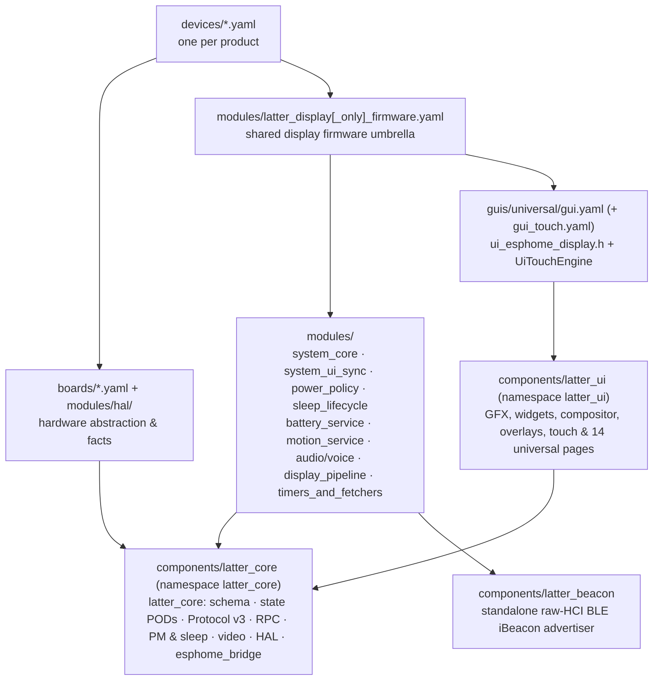

# Architecture

## Acyclic 3-Component Firmware Architecture



Each product file in `devices/` combines its board HAL with the shared display umbrella (`modules/latter_display_firmware.yaml`, or `modules/latter_display_only_firmware.yaml` for audio-less / touch-optional displays) and three compiled C++20 PlatformIO components (`latter_core`, `latter_ui`, `latter_beacon`). Every hand-authored header and translation unit sits inside a zero-cycle `#include` graph enforced by full Tarjan SCC plus coarse component/header boundaries in `tools/verify_core/`:

- **`latter_core` (`namespace latter_core`) and `latter_beacon` never depend on `latter_ui`** (zero `ui_*.h` includes or `latter_ui::mark_dirty_*` references in core headers or TUs; zero `using namespace` directives in headers).
- **Inside `include/ui_*.h` (`namespace latter_ui`)**, only `ui_esphome_display.h` may include `esphome/*` or `hal_*.h`, keeping the entire graphics, widget, compositor, touch, and 14-page rendering engine pure C++20 and host-compilable. `ui_gfx` decouples from `page_weather` via `register_psram_cache_evictor()` / `evict_registered_psram_caches()`.
- **Inside `components/latter_ui/`**, `components/latter_ui/__init__.py` stages all 20 `ui_*.h` headers (`STAGED_HEADERS`) with minimal `GLOBAL_YAML_INCLUDES = ("ui_esphome_display.h",)` whenever `capabilities.display` is true (screenless nodes omit `latter_ui` cleanly via `latter_core.AUTO_LOAD`). ESP-IDF heap/DMA headers stay isolated to `ui_gfx.cpp` and `ui_mdi.cpp`, and domain page renderers never include sibling `page_*.cpp` files (only `page_router.cpp` dispatches across pages).

```yaml
# devices/pocket-assistant.yaml (abridged)
external_components:
  - source: { type: git, url: https://github.com/slampton/esphome-latter-core, ref: ${latter_ref} }
    components: [latter_core, latter_ui, latter_beacon]
    refresh: 0s

packages:
  hal:             !include ../boards/waveshare_s3_175c.yaml
  latter_firmware: !include ../modules/latter_display_firmware.yaml
```

Device files define only what varies per SKU: `wifi` (`id: wifi_ctrl`), `latter_beacon` (`id: ble_ctrl` + `minor`), `improv_serial`, the `Project Firmware` HTTPS OTA manifest URL, and product default substitutions. All volatile runtime state lives in `DeviceRuntimeState` (`latter_core::runtime_state()`, `include/state/device_runtime_state.h`) and all persisted device preferences live in `PersistedDevicePrefs` v1 (variable-length NVS blob) + cold-boot `HibernateSnapshot` v3 (`include/state/state_nvs_snapshot.h`), with **zero YAML `globals:`**.

---

## Why Custom C++20 UI Instead of LVGL?

LVGL is a solid general-purpose widget toolkit, and ESPHome ships first-class integration for it—but Latter's target displays span 320×480 SPI panels, 410×502 / 466×466 QSPI AMOLEDs, 720×720 MIPI-DSI square panels, and 800×480–1280×800 landscape panels while running full-duplex 48 kHz audio, microWakeWord, Sendspin streaming, and MJPEG cameras concurrently in the same address space. Writing a small, self-contained C++20 immediate-mode renderer directly over `Rgb565Surface` gave us deterministic memory, flush bandwidth, and testing guarantees that an object-tree toolkit makes hard to hold:

- **Contiguous `stride == W` `2px` dirty-band DMA:** `DirtyBandTracker` aligns partial redraws (clock ticks, timers, sliders, dock focus) to even-to-odd full-width scanline bands `[y0, y1]` across `0 .. W - 1`, preserving `MipiSpiBuffer`'s zero-copy contiguous DMA fast path while cutting SPI/QSPI bus traffic 5–12× without tile-stitching stalls.
- **One 9-geometry responsive engine with zero object-tree RAM overhead:** All 14 apps share a single immediate-mode layout and co-located `FrameHitTable` (`kMaxRegions = 128`, physical millimetre targets from `LATTER_PANEL_PPI`) scaling isotropically from compact wearables to `720×720` square and `1024×600` / `1280×800` landscape panels—with zero retained widget trees, per-object style allocations, or heap fragmentation across view transitions.
- **PSRAM-budgeted `SkyBaseCache` procedural weather:** Static sky gradients, star domes, cumulus layers, and a 139×139 spherical-terminator lunar disc bake once into PSRAM (`SkyBaseCache`, mutually coordinated with `ArtCache` via `register_psram_cache_evictor()`), letting stateless Q8 fixed-point rain, snow, and plasma-corona lightning composite directly over RGB565 scanlines with zero floating-point trig in per-pixel loops.
- **Native 9-geometry ASan/UBSan C++20 host tests:** Because every UI header except `ui_esphome_display.h` has zero ESPHome or ESP-IDF includes, CI compiles and executes all 14 page renderers, hit-table geometry invariants, and touch/rotary dispatch natively on the host across all 9 panel geometries (5 flagships + `360×360` round, `800×480`, `1024×600`, and `1280×800`) under AddressSanitizer and UndefinedBehaviorSanitizer in seconds—no simulator harness or device-in-the-loop required.

---

## Directory Map

### `boards/`: Hardware Abstraction & Machine Facts
Each board pairs `boards/<board_id>.yaml` with a schematic-verified `boards/facts/<board_id>.json` ledger checked by `tools/check_boards.py` (and `tools/check_boards.py --external` for community boards):
- **Typed `latter_core:` YAML board schema:** declares `board_id`, `ble_minor`, `gui`, `chip`, `psram_mb`, `display:`, `backlight:`, `power:`, `audio:`, `capabilities:`, explicit opt-in `drivers:` (`LATTER_DRV_*` I2C guards), and `diagnostics:` (`nvs_guard`, `twdt_breadcrumb`), emitting validated `LATTER_*` macros into `esphome/core/defines.h` without raw `build_flags`.
- **Buses & peripherals:** display (`mipi_spi` or `mipi_dsi`), touchscreen (`platform: latter_core`), I2C, GPIO pins, and HAL scripts (`hal_release_deep_sleep_holds`, `hal_enter_hardware_hibernate`).
- **Shared HAL packages (`modules/hal/`):** pure chip/peripheral modules (`chip_esp32s3.yaml`, `chip_esp32p4.yaml`, `radio_esp32c6_sdio.yaml`, `audio_es8311_duplex.yaml`, `audio_es8311_es7210_duplex.yaml`, `pmu_axp2101.yaml`, `imu_qmi8658.yaml`) with zero UI/audio UX coupling. → [Porting hardware](porting-hardware.md)

### `modules/`: Core OS YAML Modules

| File | Role |
| :--- | :--- |
| `latter_display_firmware.yaml` & `latter_display_only_firmware.yaml` | Display umbrellas: `latter_display_only_firmware.yaml` provides the audio-less/touch-optional display profile (`logger:`, `safe_mode:`, core modules, `guis/universal/gui.yaml`), and `latter_display_firmware.yaml` composes directly on top of it to add `audio_*` and `gui_touch.yaml`. |
| `system_core.yaml` & `system_ui_sync.yaml` | Unified core foundation: `version: "3.0.0"`, `${latter_asset_ref}` default, Native API (`batch_delay: 0ms`, Noise `encryption:`, `outgoing_connection:`), `time:` (`ha_time` + `sntp_time`), `send_device_hello`, `System: RPC Outbox` (`latter_rpc_outbox`, auto-hidden in Home Assistant), `LATTER_CORE_REV == LATTER_YAML_REV` (`2026112501`), all 9 Native API actions (`latter_ping`, `latter_push_v3`, `latter_device_command`, `latter_set_slots`, `latter_show_notification`, `latter_set_beacon_uuid`, `latter_factory_reset`, `latter_set_calendar_view`, `latter_set_music_lyrics`), deduplicated pull + Noise-encrypted push OTA (`ota_on_begin` / `handle_ota_*`), `PersistedDevicePrefs` v1 + `HibernateSnapshot` v3 hydration, and UI sync / `ui_input_event` dispatch. |
| `power_policy.yaml` & `sleep_lifecycle.yaml` | Power state machine (active, screensaver, screen-off quiet, hibernate), `1 s` lifecycle supervisor (`DisplayLifecycleController`), `20 ms` cadence tick (`FrameCadenceController`), hibernate sequencing, and script `apply_power_policy`—the sole owner of the `latter_awake` lock. |
| `battery_service.yaml` & `motion_service.yaml` | Hardware-agnostic battery telemetry / PWR-key UX / low-battery cutoff service (included by battery boards) and generic raise-to-wake / shake UX service consuming any IMU HAL's `hw_accel_*` / `ImuPowerMode` hooks. |
| `audio_pipeline.yaml`, `voice_assistant.yaml` & `audio_scripts.yaml` | Audio mixer, Sendspin `Music` media player + album art, `micro_wake_word` (`models/`), `voice_assistant`, internal WAV `latter_sound_player` (`sounds/<rate>/`), and `DeviceRuntimeState::AudioRuntimeHooks` (`rs.audio.*`) coordinated by `AudioPathArbitrator` and `AudioSessionController`. |
| `display_pipeline.yaml` | `http_request`, `online_image` slots (artwork, wallpaper, screensaver photo, camera; baseline JPEG decoded to RGB565 in PSRAM), and internal `display_brightness` (`internal: true`, `hal_set_display_brightness`, mirrored to Home Assistant via `display_state` RPC onto `light.<slug>_screen` and `switch.<slug>_screensaver`). |
| `timers_and_fetchers.yaml` | 1 Hz countdown timer & recurring alarm evaluation (`TimerAlarmController`), event-driven `timer_alarm_state` & `device_telemetry` RPC emission, and outbound fetch helpers. |
| `hal/chip_esp32s3.yaml`, `hal/chip_esp32p4.yaml`, `hal/radio_esp32c6_sdio.yaml` | Shared chip `sdkconfig_options`, ESP32-S3 automatic FreeRTOS light sleep (`240/80 MHz`), ESP32-P4 fixed-`CPLL` / `200 MHz` PSRAM + `esp_ldo` PHY rail, and parameterized ESP32-C6 SDIO Wi-Fi/BLE co-processor (omitted on Ethernet-only P4 boards). |
| `hal/audio_es8311_duplex.yaml`, `hal/audio_es8311_es7210_duplex.yaml` | Full-duplex 48 kHz I2S bus, ES8311 / ES7210 codecs, `physical_speaker` (`timeout: 4s`), `latter_mic` resampler microphone (16 kHz), and codec mute/standby scripts. |
| `hal/pmu_axp2101.yaml`, `hal/imu_qmi8658.yaml` | Pure chip HALs for AXP2101 PMU (+ PCF85063 RTC when `LATTER_DRV_RTC_PCF85063=1`) and QMI8658 IMU (`ImuPowerMode` + WoM `INT1`) decoupled from UI/audio UX. |

### `include/` & `components/`: 3-Component Compiled C++20 Platform

| Component | Staged Headers & Compiled Translation Units |
| :--- | :--- |
| **`components/latter_core/`** *(`namespace latter_core`, zero `ui_*.h` coupling)* | **Headers (`include/` & `include/state/`, 28 `STAGED_HEADERS`, 9 minimal `GLOBAL_YAML_INCLUDES`):** `latter_traits.h`, `state/{state_common,state_prefs,state_shortcuts,state_nav,state_media,state_areas,state_weather_cal,state_time_alarms,state_alerts_intercom,device_runtime_state,state_nvs_snapshot}.h`, `esphome_bridge.h`, `hal_manifest.h`, `hal_battery.h`, `hal_imu_qmi8658.h`, `hal_panel_power.h`, `hal_{sleep_pm,radio_policy,display_lifecycle}.h`, `hal_touch.h`, `hal_video_stream.h`, `hal_link_report.h`, `audio_router.h`, `latter_protocol.h` (generated, with `constexpr` `PrefContractSpec` & per-pref defaults/bounds), `latter_rpc.h`, `latter_actions.h`, `latter_prof.h`.<br/>**Flat TUs (`components/latter_core/`):** `state_prefs_nvs.cpp`, `state_v3_domains.cpp`, `state_v3_actions.cpp`, `latter_rpc.cpp`, `latter_actions.cpp`, `power_battery.cpp`, `audio_es8311.cpp`, `audio_session.cpp`, `imu_qmi8658.cpp`, `touch_hal.cpp`, `pm_light_sleep.cpp`, `pm_telemetry_stall.cpp`, `weak_link_policy.cpp`, `display_lifecycle.cpp`, `video_{parser,decoder,client_esp}.cpp`, `core_store.cpp`, `runtime_controllers.cpp`, `device_sync_controllers.cpp`, `esphome_bridge.cpp`. Auto-loads `latter_ui` when `capabilities.display` is true. |
| **`components/latter_ui/`** *(`namespace latter_ui`, universal display UI)* | **Staged Headers (`STAGED_HEADERS`, 20 `ui_*.h`, `GLOBAL_YAML_INCLUDES = ("ui_esphome_display.h",)`):** pure leaves (`ui_{color,surface,panel_traits,widget_ids,hit_table,panel_metrics,page_geoms,types}.h`), host-compilable GFX/widgets/compositor/pages/touch (`ui_{mdi,frame_context,dirty_band,cadence,compositor,gfx,widgets,layout,pages,touch_recognizer,touch_engine}.h`), and sole ESPHome bridge (`ui_esphome_display.h`).<br/>**Flat TUs (`components/latter_ui/`):** `hit_table`, `ui_gfx`, `ui_gfx_text_art`, `ui_mdi`, `ui_widgets`, `ui_widgets_icons_chrome`, `ui_compositor`, `overlay_{notification,quick_actions,takeover,voice_assistant}`, `touch_engine`, `touch_dispatch_{nav,home_area,music,time_cal,cameras_games,system_tools}`, `page_router`, `weather_sky_fx`, `games_{imu,touch}`, `screensaver_fx`, `showcase_engine`, and 14 domain renderers (`page_{clock,home,time,music,area_hub,home_hub,cameras,remote,weather,calendar,tools,pinned,games,system}.cpp`), compiled whenever `capabilities.display` is true. |
| **`components/latter_beacon/`** *(standalone BLE component)* | `latter_beacon.h` / `latter_beacon.cpp`: raw-HCI BLE iBeacon advertiser (`ble_ctrl`) over VHCI or `esp32_hosted` with zero Bluedroid/NimBLE host-stack RAM and `< 1 ms` warm `pause()`/`enable()` transitions; never depends on `latter_ui`. |

### `guis/`, `examples/`, `manifests/` & `index.html`
- **`guis/universal/gui.yaml` & `gui_touch.yaml`**: Thin declarative shell with fonts, WCAG-verified palette, `!extend disp1` render lambda delegating to `render_esphome_display_frame()` (`ui_esphome_display.h` + `ui_compositor.cpp`), and optional `!extend touch_screen` binding in `gui_touch.yaml` (omitted on rotary-only `LATTER_HAS_TOUCH=0` builds). → [Device UI design guide](device-ui-design.md)
- **`examples/bringup/`**: Hardware bring-up probes generated by `tools/new_board.py --bringup`.
- **`manifests/` & `index.html`**: GitHub Pages ESP Web Tools installer and per-device/per-silicon release manifests.

---

## Power Management, Sleep & OTA Safety

- **Single Awake-Lock Owner (`latter_awake`).** Coordinated exclusively in [`components/latter_core/`](../components/latter_core/) (`pm_light_sleep.cpp` / `include/hal_sleep_pm.h`) via `apply_power_policy` (`latter_core::pm_apply()`). Held while the screen or screensaver is active, USB power is connected, or audio, wake word, Assist, OTA, games, ringing alarms/timers, Find My, alerts, or doorbell audio are active; released only in battery screen-off quiet.
- **ESP32-S3 Automatic Light Sleep (`~5–8 mA`).** `chip_esp32s3.yaml` enables `enable_light_sleep: true` (`240 MHz` max / `80 MHz` min, `CONFIG_PM_POWER_DOWN_CPU_IN_LIGHT_SLEEP: "n"`). Releasing `latter_awake` arms GPIO wake pins (`LATTER_PWR_KEY_PIN`, `LATTER_ACTION_BTN_PIN`, `LATTER_TOUCH_INT_PIN`, `LATTER_IMU_INT1_PIN` with ISR edge re-delivery), pauses `latter_beacon` in `< 1 ms` via `HCI_LE_Set_Adv_Enable(0)` (staying active on USB when `ble_beacon_mode == "Always"`), and stretches the main loop to **`1,000 ms`** (**`250 ms`** while touch wake is armed). Smoothed RSSI below **`-78 dBm`** holds `weak_link` awake until RSSI stays above **`-74 dBm`** for 2 minutes (`#ifdef USE_WIFI`-guarded so Ethernet-only boards compile cleanly); off-site (`!wifi_connected`), Wi-Fi scans back off exponentially (`15 s -> 60 s -> 300 s`, `~2–4 mA`).
- **ESP32-P4 Fixed-CPLL Quiet Loop & MIPI-DSI OTA.** ESP32-P4 boards intentionally omit `power_management:` (`40 MHz` XTAL DFS retunes MSPI timing across `esp_hosted` SDIO DMA and causes WDT resets), keeping fixed `CPLL` (`360` / `400 MHz`) + `200 MHz` PSRAM and pacing battery screen-off loops at `1,000 ms` (`250 ms` touch wake) so both RISC-V cores idle in `wfi`. On MIPI-DSI targets (`display.dsi_iram_safe: true`), ESPHome `2026.11.0+` natively places the MIPI-DSI refresh callback in IRAM (`CONFIG_LCD_DSI_ISR_CACHE_SAFE`), paired with `CONFIG_DW_GDMA_ISR_IRAM_SAFE: "y"` (`>= 10%` / `>= 800 ms` OTA redraws) so DPI scanout never tears during flash erases on ESP-IDF 5.5 and 6.1+.

---

## Build, CI & Requirements

- **Validation Gate (`validate.yml`):** Runs `tools/verify_core.py`, `tools/gen_protocol.py --check --require-sibling`, `tools/check_protocol_usage.py`, `tools/check_boards.py --release --check-docs`, `tools/new_board.py --bringup --check`, `tools/gen_sounds.py --check`, `tools/gen_mdi_pack.py --check`, 9-geometry C++20 host unit tests (`tests/host/*.cpp`), `esphome config` across `examples/bringup/*.yaml` and all 5 flagship devices, and full 6-variant firmware compilation on `dev` before fast-forwarding `main`.
- **Release (`release.yml`):** Enforces zero `L`-confidence board facts (`check_boards.py --release --check-docs`), compiles all device and P4 silicon variants in `esphome/esphome:2026.11.1`, generates MD5 OTA manifests + `.elf` debug symbols, and deploys the Web Installer to GitHub Pages.
- **Compiler Requirements:** ESPHome `2026.11.1+` (`ESPHOME_VERSION_CODE` + `LATTER_CORE_REV == LATTER_YAML_REV` static asserts in `include/esphome_bridge.h` / `modules/system_core.yaml`), ESP-IDF 5.5+ C++20, PSRAM full-frame RGB565 display buffers, `CONFIG_COMPILER_OPTIMIZATION_PERF: "y"` (`-O2`), and `CONFIG_SPIRAM_MALLOC_ALWAYSINTERNAL: "128"`.
