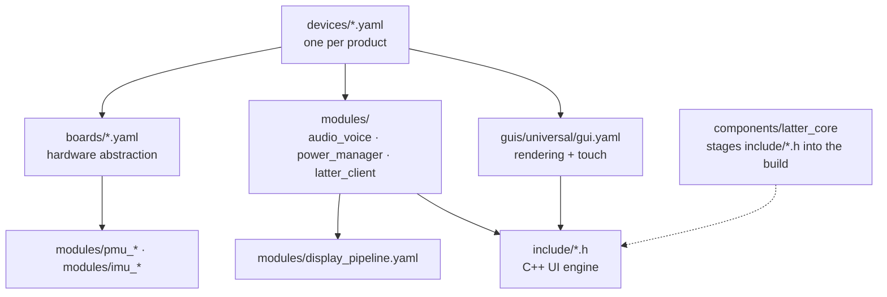

# Architecture

## Layers



A device config is just a list of packages:

```yaml
# devices/pocket-assistant.yaml (abridged)
external_components:
  - source: { type: git, url: https://github.com/slampton/esphome-latter-core, ref: main }
    components: [latter_core]
    refresh: 0s

latter_core:

packages:
  hal:                !include ../boards/waveshare_s3_175c.yaml
  latter_audio_voice: !include ../modules/audio_voice.yaml
  latter_power:       !include ../modules/power_manager.yaml
  latter_client:      !include ../modules/latter_client.yaml
  latter_gui:         !include ../guis/universal/gui.yaml
```

Device files also define the parts that differ per product: the `wifi` id, the `esp32_ble` id, the iBeacon minor, the update source, and default substitutions (power profile, clock face, font sizes).

---

## Directory map

### `boards/`: hardware abstraction (one file per board)
A board file defines:
- **Hardware:** the display, touchscreen, I2C/SPI buses, I2S, and audio codecs.
- **Modules:** which PMU and IMU modules to include.
- **Build settings:** the `LATTER_*` capability flags and sdkconfig options.
- **HAL scripts:** the scripts the core calls, such as `hal_route_i2s_to_spk` and `hal_enter_hardware_hibernate`.

→ [Porting hardware](porting-hardware.md)

### `modules/`: the core

| File | Role |
| :--- | :--- |
| `latter_client.yaml` | The Latter protocol client. Covers boot sequence, API actions, every Home Assistant subscription, global state, user-facing selects, switches, and numbers, and the scripts that call `latter.*` services. Also the input router (`ui_input_event`), theme and brightness, and OTA hooks. Includes `display_pipeline.yaml`. |
| `display_pipeline.yaml` | `http_request`, Sendspin album art, 3 `online_image` slots (artwork, wallpaper, camera; JPEG decoded to RGB565 at screen size), backlight output with a gamma curve, and the Display light |
| `audio_voice.yaml` | Mixer, resamplers, Sendspin media source, media player, micro_wake_word, voice_assistant, RTTTL alarms and sound effects, plus the voice and TTS lifecycle scripts |
| `power_manager.yaml` | The power state machine (active, screensaver, screen off, hibernate), sleep and wake selects, 1 s and 50 ms supervisors, hibernate sequencing |
| `pmu_axp2101.yaml` / `pmu_none.yaml` | Battery, USB, and crown-button handling, or stubs for mains-powered boards |
| `imu_qmi8658.yaml` / `imu_none.yaml` | Accelerometer, tilt, and shake detection, or stubs that return constants |
| `base.yaml` | Minimal identity, time sync, `latter_ping`, and a static hardware manifest, for headless nodes |
| `area_control.yaml` | Area subscription plus binding and area-action scripts, for headless nodes |
| `display_ui.yaml` | Convenience umbrella that bundles `latter_client.yaml` and the universal GUI. Used by `examples/custom_display_template.yaml`. |

### `guis/universal/gui.yaml`: the GUI
Fonts, the color palette, the `display:` render lambda (an `!extend` of `disp1`), and touch gesture handling (an `!extend` of `touch_screen`). It defines no API. Everything it needs comes from `latter_client.yaml`. → [Building a GUI](building-a-gui.md)

### `include/`: C++ UI engine
| Header | Contents |
| :--- | :--- |
| `ui_core.h` | `LATTER_*` defaults, screen constants, scaling helpers, page IDs, trig and chord lookup tables, drawing primitives, the album-art blitter, the redraw scheduler, the flight recorder |
| `ui_layout.h` | `UiLayout` geometry and hit-testing, hardware manifest builder, backlight PWM, Wi-Fi power save, dock and mode-bar animation, focus engine, OTA helpers, the P4 DSI IRAM wrapper |
| `ui_clock_home.h` | Clock faces, home page, app dock |
| `ui_music.h` | Music pages |
| `ui_area_home_hub.h` | Area Control and Whole-Home Hub |
| `ui_remote.h` | Remote |
| `ui_weather_sky.h` | Weather page and animated sky |
| `ui_tools.h` | Tools, alarm and timer overlays, notification overlay |
| `ui_games.h` | The 6 games and the launcher |
| `ui_ambient_va.h` | Screensavers and the voice overlay |
| `ui_system.h` | Settings page |
| `va_cancel_helper.h` | Voice session teardown, wake word persistence, Sendspin stereo-to-mono downmix |
| `latter_state.h` | Typed per-domain state, plus allocation-free parsers for the packed (`\x1f` / `\x1e`) protocol payloads |

### `components/latter_core/`
An ESPHome external component that copies the 13 headers from `include/` into the build's `src/` directory, adds an `#include` for each, and adds `using namespace latter_ui;`. Adding `latter_core:` to a config is what makes the headers available to lambdas.

### `mixins/`
Standalone packages for your own configs. → [Mixins](mixins.md)

### `examples/`
| File | What it shows |
| :--- | :--- |
| `minimal_headless_companion.yaml` | A bare ESP32-S3 dev board with `base.yaml`, `area_control.yaml`, and `ble_beacon`. No display. |
| `custom_display_template.yaml` | A complete 480×480 board HAL with stub HAL scripts, running the full core and universal GUI. Start here when porting. |

### `manifests/` and `index.html`
The ESP Web Tools installer page and per-device manifests. The release workflow rebuilds the manifests with real checksums when it publishes.

---

## Build and release

- **CI** ([`validate.yml`](../.github/workflows/validate.yml)) runs `esphome config` on both examples for every push to `main` and `dev`.
- **Release** ([`release.yml`](../.github/workflows/release.yml)) runs on a `v*` tag:
  1. Compiles all five devices with the `esphome/esphome:2026.10.1` container.
  2. Writes manifests with each OTA image's MD5.
  3. Publishes the binaries, manifests, and installer page to GitHub Pages.
- **Device configs pull `latter_core` and the packages from `main`.** A build always uses the current `main`, even when it's triggered from a tag.

## Requirements for building

- **ESPHome:** 2026.10.0 or newer. `min_version` is set in the device configs, and `va_cancel_helper.h` enforces the same version with a `static_assert`.
- **Framework:** ESP-IDF, with C++20. The default for ESPHome 2026.10 is sufficient.
- **PSRAM:** required on every board.
- **Compiler settings:** `CONFIG_COMPILER_OPTIMIZATION_PERF` (`-O2`) and `CONFIG_SPIRAM_MALLOC_ALWAYSINTERNAL=256` on every board.
