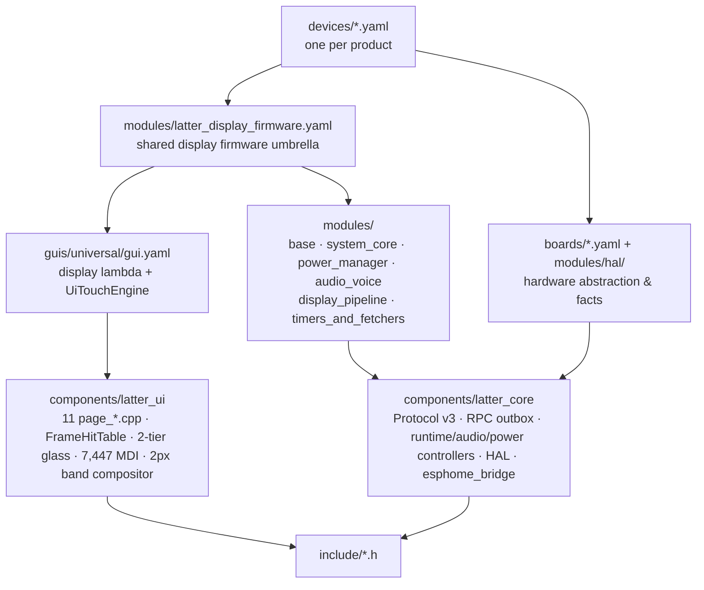

# Architecture

## Layers



Each product file in `devices/` combines its board HAL with the shared display umbrella and the three compiled C++20 PlatformIO components (`latter_core`, `latter_ui`, `latter_beacon`):

```yaml
# devices/pocket-assistant.yaml (abridged)
external_components:
  - source: { type: git, url: https://github.com/slampton/esphome-latter-core, ref: ${latter_ref} }
    components: [latter_core, latter_ui, latter_beacon]
    refresh: 0s

packages:
  hal:             !include ../boards/waveshare_s3_175c.yaml
  latter_firmware: !include ../modules/latter_display_firmware.yaml
```

Device files define only what varies per SKU: `wifi` (`id: wifi_ctrl`), `latter_beacon` (`id: ble_ctrl` + `minor`), `improv_serial`, the `Project Firmware` HTTPS OTA manifest URL, and product default substitutions. All volatile runtime state lives in `DeviceRuntimeState` and all 50 persisted device preferences live in `PersistedDevicePrefs` v6 + cold-boot `HibernateSnapshot` v2 (`include/latter_state.h`), with **zero YAML `globals:`**.

---

## Directory Map

### `boards/`: Hardware Abstraction & Machine Facts
Each board pairs `boards/<board_id>.yaml` with a schematic-verified `boards/facts/<board_id>.json` ledger checked by `tools/check_boards.py`:
- **Buses & peripherals:** display (`mipi_spi` or `mipi_dsi`), touchscreen, I2C, and GPIO pins.
- **Shared HAL packages (`modules/hal/`):** chip config (`chip_esp32s3.yaml` or `chip_esp32p4.yaml`), full-duplex 48 kHz audio (`audio_es8311_duplex.yaml` or `audio_es8311_es7210_duplex.yaml`), plus optional `pmu_axp2101.yaml` and `imu_qmi8658.yaml`.
- **Compile-time traits:** explicit `LATTER_*` capability flags (`LATTER_SCREEN_W/H`, `LATTER_PANEL_PPI`, `LATTER_HAS_IMU`, `LATTER_HAS_BATTERY`, `LATTER_HAS_RTC`, etc.) and HAL scripts (`hal_release_deep_sleep_holds`, `hal_enter_hardware_hibernate`). → [Porting hardware](porting-hardware.md)

### `modules/`: Core OS (13 YAML Modules)

| File | Role |
| :--- | :--- |
| `latter_display_firmware.yaml` | Umbrella package for display builds: configures `latter_core:`, boot-log replay (`logger:`), `safe_mode:`, all core modules below, and `guis/universal/gui.yaml`. |
| `base.yaml` | Shared foundation for both display and headless nodes: Native API (`batch_delay: 0ms`, Noise `encryption:`, `outgoing_connection:`), `latter_ping` (`id: latter_ping_action`), `latter_push_v3`, `latter_device_command`, `time:` (`ha_time` + `sntp_time`), `send_device_hello`, `System: Hardware Manifest`, and `System: RPC Outbox` (`latter_rpc_outbox`). |
| `system_core.yaml` | Includes `base.yaml`, enforces `LATTER_SDK_REV == LATTER_YAML_REV`, declares display Native API actions (`latter_set_slots`, `latter_show_notification`, `latter_set_beacon_uuid`, `latter_factory_reset`, `latter_ui_input`), deduplicates pull + Noise-encrypted push OTA (`handle_ota_*`), exposes diagnostic controls (`Actions: Restart Device`, `System: Log Memory Report`, `System: Telemetry Profiler`, `System: Link Report`), restores cold-boot UTC from PCF85063 RTC (`LATTER_HAS_RTC=1`), and hydrates `PersistedDevicePrefs` v6 + `HibernateSnapshot` v2. |
| `power_manager.yaml` | Power state machine (active, screensaver, screen-off quiet, hibernate), `1 s` lifecycle supervisor (`DisplayLifecycleController`), `20 ms` cadence tick (`FrameCadenceController`), hibernate sequencing, and script `apply_power_policy`—the sole owner of the `latter_awake` lock. |
| `audio_voice.yaml` | Audio mixer, Sendspin `Music` media player, `micro_wake_word` (`models/`), `voice_assistant`, internal WAV `latter_sound_player` (`sounds/<rate>/`), and voice/TTS lifecycle hooks coordinated by `AudioPathArbitrator` and `AudioSessionController`. |
| `display_pipeline.yaml` | `http_request`, Sendspin album art, 3 `online_image` slots (artwork, wallpaper, camera; baseline JPEG decoded to RGB565 in PSRAM), and `Display: Screen Backlight` (`hal_set_display_brightness`). |
| `timers_and_fetchers.yaml` | 1 Hz countdown timer & recurring alarm evaluation (`TimerAlarmController`), event-driven `timer_alarm_state` RPC emission, and outbound fetch helpers. |
| `hal/chip_esp32s3.yaml`, `hal/chip_esp32p4.yaml` | Shared chip `sdkconfig_options`, ESP32-S3 automatic FreeRTOS light sleep (`240/80 MHz`), and ESP32-P4 fixed-`CPLL` / `200 MHz` PSRAM + `esp_ldo` PHY rail + `esp32_hosted` PSRAM SDIO setup (no P4 DFS). |
| `hal/audio_es8311_duplex.yaml`, `hal/audio_es8311_es7210_duplex.yaml` | Full-duplex 48 kHz I2S bus, ES8311 / ES7210 codecs, `physical_speaker` (`timeout: 4s`), `latter_mic` resampler microphone (16 kHz), and codec mute/standby scripts. |
| `hal/pmu_axp2101.yaml`, `hal/imu_qmi8658.yaml` | Optional AXP2101 battery/charger/PWR-key telemetry (+ PCF85063 RTC when `LATTER_HAS_RTC=1`) and QMI8658 accelerometer/tilt/wake-on-motion packages. |

### `include/` & `components/`: 3-Component Compiled C++20 SDK

| Component | Staged Headers & Compiled Translation Units |
| :--- | :--- |
| **`components/latter_core/`** *(13 headers, 8 `.cpp` TUs)* | **Headers (`include/`):** `esphome_bridge.h`, `hal_manifest.h`, `hal_battery.h`, `hal_imu_qmi8658.h`, `hal_panel_power.h` (LEDC PWM + SPI/QSPI DCS `0x10`/`0x11` sleep templates), `hal_power_pm.h` (`DisplayLifecycleController`, `CoreTimeoutBridge`), `hal_link_report.h`, `audio_router.h` (`AudioPathArbitrator`, `AudioSessionController`, `IntercomSessionController`, C++ media actions), `latter_protocol.h` (generated), `latter_state.h` (`PersistedDevicePrefs` v6, `HibernateSnapshot` v2, `V3DomainReducer`, `TimerAlarmController`), `latter_rpc.h`, `latter_actions.h`, `latter_prof.h`.<br/>**TUs:** `power_battery.cpp` (AXP2101 + OCV/fuel-gauge + PCF85063 RTC), `audio_es8311.cpp`, `audio_session.cpp`, `imu_qmi8658.cpp`, `panel_power.cpp` (touch monitor-mode bus helper), `power_pm.cpp`, `runtime_controllers.cpp`, `esphome_bridge.cpp`, plus `LatterLoopProbe` (`latter_core.h`) and `--wrap=nvs_set_blob` / `--wrap=esp_flash_erase_region` `[PROF:FLASH]` probes. Auto-loads `latter_ui` unless `latter_core: gui: "none"` is set. |
| **`components/latter_ui/`** *(9 headers, 17 `.cpp` TUs)* | **Headers (`include/`):** `ui_types.h`, `ui_gfx.h` (`fast_*` RGB565 primitives & 2-tier neutral glass), `ui_mdi.h` (7,447 baked MDI vector icons), `ui_hit_table.h` (`FrameHitTable`), `ui_layout.h` (`UiLayout` & mm gesture math), `ui_widgets.h`, `ui_compositor.h` (`DirtyBandTracker`, `FrameCadenceController`, `render_system_takeovers`), `ui_touch_engine.h` (`UiTouchEngine`), `ui_pages.h`.<br/>**TUs:** `ui_gfx.cpp`, `ui_mdi.cpp`, `ui_widgets.cpp`, `ui_compositor.cpp`, `hit_table.cpp`, `touch_engine.cpp`, and **11 domain renderers**: `page_clock_home.cpp`, `page_time.cpp`, `page_music.cpp`, `page_area_hub.cpp`, `page_home_hub.cpp`, `page_remote.cpp`, `page_weather.cpp`, `page_tools.cpp`, `page_games.cpp`, `page_ambient_va.cpp`, `page_system.cpp`. |
| **`components/latter_beacon/`** | `latter_beacon.h` / `latter_beacon.cpp`: raw-HCI BLE iBeacon advertiser (`ble_ctrl`) over VHCI on ESP32-S3 or `esp_hosted` on ESP32-P4 with zero Bluedroid/NimBLE host-stack RAM and `< 1 ms` warm `pause()`/`enable()` transitions. |

### `guis/`, `examples/`, `manifests/` & `index.html`
- **`guis/universal/gui.yaml`**: Fonts, WCAG-verified palette, `!extend disp1` render lambda (`DirtyBandTracker` `2px` dirty bands + `render_system_takeovers` + 11 `page_*.cpp` views), and `!extend touch_screen` forwarding into `UiTouchEngine`. → [Building a GUI](building-a-gui.md)
- **`examples/`**: `minimal_headless_companion.yaml` (`modules/base.yaml` + `gui: "none"`), `custom_display_template.yaml` (standalone 480×480 board + GUI template), and `bringup/*.yaml` (`tools/new_board.py --bringup`).
- **`manifests/` & `index.html`**: GitHub Pages ESP Web Tools installer and per-device/per-silicon release manifests.

---

## Power Management, Sleep & OTA Safety

- **Single Awake-Lock Owner (`latter_awake`).** Coordinated exclusively in [`power_pm.cpp`](../components/latter_core/power_pm.cpp) (`include/hal_power_pm.h`) via `apply_power_policy`. Held while the screen or screensaver is active, USB power is connected, or audio, wake word, Assist, OTA, games, ringing alarms/timers, Find My, alerts, or doorbell audio are active; released only in battery screen-off quiet.
- **ESP32-S3 Automatic Light Sleep (`~5–8 mA`).** `chip_esp32s3.yaml` enables `enable_light_sleep: true` (`240 MHz` max / `80 MHz` min, `CONFIG_PM_POWER_DOWN_CPU_IN_LIGHT_SLEEP: "n"`). Releasing `latter_awake` arms GPIO wake pins (`LATTER_PWR_KEY_PIN`, `LATTER_ACTION_BTN_PIN`, `LATTER_TOUCH_INT_PIN`, `LATTER_IMU_INT1_PIN` with ISR edge re-delivery), pauses `latter_beacon` in `< 1 ms` via `HCI_LE_Set_Adv_Enable(0)` (staying active on USB when `ble_beacon_mode == "Always"`), and stretches the main loop to **`1,000 ms`** (**`250 ms`** while touch wake is armed). Smoothed RSSI below **`-65 dBm`** holds `weak_link` awake until RSSI stays above **`-61 dBm`** for 2 minutes; off-site (`!wifi_connected`), Wi-Fi scans back off exponentially (`15 s -> 60 s -> 300 s`, `~2–4 mA`).
- **ESP32-P4 Fixed-CPLL Quiet Loop & MIPI-DSI OTA.** ESP32-P4 boards intentionally omit `power_management:` (`40 MHz` XTAL DFS retunes MSPI timing across `esp_hosted` SDIO DMA and causes WDT resets), keeping fixed `CPLL` (`360` / `400 MHz`) + `200 MHz` PSRAM and pacing battery screen-off loops at `1,000 ms` (`250 ms` touch wake) so both RISC-V cores idle in `wfi`. On `waveshare_p4_86_panel.yaml`, ESPHome `2026.11.0+` natively places the MIPI-DSI refresh callback in IRAM (`CONFIG_LCD_DSI_ISR_CACHE_SAFE`), paired with `CONFIG_GDMA_ISR_IRAM_SAFE: "y"`, `CONFIG_DW_GDMA_ISR_IRAM_SAFE: "y"`, and `-DLATTER_DSI_IRAM_SAFE=1` (`>= 10%` / `>= 800 ms` OTA redraws) so DPI scanout never tears during flash erases.

---

## Build, CI & Requirements

- **Validation Gate (`validate.yml`):** Runs `tools/verify_core.py`, `tools/gen_protocol.py --check`, `tools/check_protocol_usage.py`, `tools/check_boards.py --check-docs`, `tools/new_board.py --bringup --check`, `tools/gen_sounds.py --check`, `tools/gen_mdi_pack.py --check`, C++20 host unit tests (`tests/host/test_all.cpp`), `esphome config` across examples/probes/devices, and full 5-device firmware compilation on `dev` before fast-forwarding `main`.
- **Release (`release.yml`):** Enforces zero `L`-confidence board facts (`check_boards.py --release --check-docs`), compiles all device and P4 silicon variants in `esphome/esphome:2026.11.0`, generates MD5 OTA manifests + `.elf` debug symbols, and deploys the Web Installer to GitHub Pages.
- **Compiler Requirements:** ESPHome `2026.11.0+` (`ESPHOME_VERSION_CODE` + `LATTER_SDK_REV == LATTER_YAML_REV` static asserts in `include/esphome_bridge.h`), ESP-IDF 5.5+ C++20, PSRAM full-frame RGB565 display buffers, `CONFIG_COMPILER_OPTIMIZATION_PERF: "y"` (`-O2`), and `CONFIG_SPIRAM_MALLOC_ALWAYSINTERNAL: "128"`.
