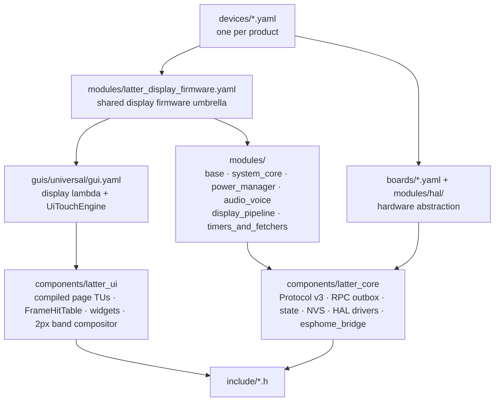

# Architecture

## Layers



A device config combines its board HAL with the shared display firmware umbrella and the three compiled SDK components (`latter_core`, `latter_ui`, `latter_beacon`):

```yaml
# devices/pocket-assistant.yaml (abridged)
external_components:
  - source: { type: git, url: https://github.com/slampton/esphome-latter-core, ref: ${latter_ref} }
    components: [latter_core, latter_ui, latter_beacon]
    refresh: 0s

packages:
  hal:             !include ../boards/waveshare_s3_175c.yaml
  latter_firmware: !include ../modules/latter_display_firmware.yaml
```

Device files define only the parts that differ per product: the `wifi` ID, the `ble_ctrl` presence beacon (`latter_beacon`: raw HCI with no host stack, over VHCI on an on-chip controller or over `esp_hosted` on the ESP32-P4) and its iBeacon minor, `improv_serial`, the firmware `update` source, and default substitutions (power profile, clock face, `api_reboot_timeout`). All runtime and persisted state lives in compiled C++ structs (`DeviceRuntimeState` and `PersistedDevicePrefs` in `include/latter_state.h`), with zero YAML `globals:`.

---

## Directory map

### `boards/`: hardware abstraction (one file per board)
A board file defines:
- **Hardware:** the display, touchscreen, I2C/SPI/MIPI-DSI buses, and GPIO pins.
- **Modules:** which shared `modules/hal/*.yaml` packages to include (`chip_esp32s3.yaml` or `chip_esp32p4.yaml`, `audio_es8311_duplex.yaml` or `audio_es8311_es7210_duplex.yaml`, and optional `pmu_axp2101.yaml` / `imu_qmi8658.yaml`).
- **Build settings:** explicit `LATTER_*` capability flags and board-specific `sdkconfig_options`.
- **HAL scripts:** board-level pad holds and hibernate entry (`hal_release_deep_sleep_holds`, `hal_enter_hardware_hibernate`).

→ [Porting hardware](porting-hardware.md)

### `modules/`: the core OS (13 YAML modules)

| File | Role |
| :--- | :--- |
| `latter_display_firmware.yaml` | Umbrella entry point included by `devices/*.yaml` and custom display builds. Configures `latter_core:`, boot-log replay (`logger:`), `safe_mode:`, all core modules, and `guis/universal/gui.yaml`. |
| `base.yaml` | Shared foundation for both display and headless nodes: Native API (`batch_delay: 0ms`, Noise `encryption:`, `outgoing_connection:`), `latter_ping` (`id: latter_ping_action`), `latter_push_v3`, `latter_device_command`, `latter_set_beacon_uuid`, `time:` (`ha_time` + `sntp_time`), `send_device_hello`, `System: Hardware Manifest`, and `System: RPC Outbox` (`latter_rpc_outbox`). |
| `system_core.yaml` | Includes `base.yaml`, enforces `LATTER_SDK_REV == LATTER_YAML_REV`, declares display-node API actions (`set_browse_slots`, `set_area_slots`, `show_notification`, `latter_factory_reset`, `ui_input`), deduplicates both OTA platforms (`http_request` pull-OTA and Noise-encrypted `esphome` `id: ota_esphome` via `handle_ota_*`), exposes diagnostic lifecycle controls (`Actions: Restart Device`, `System: Log Memory Report`, `System: Telemetry Profiler`), and wires `PersistedDevicePrefs` v2 NVS sync, the boot sequence, `boot_button`, and `ui_input_event`. |
| `power_manager.yaml` | Power state machine (active, screensaver, screen off, hibernate), 1 s and 50 ms supervisors, hibernate sequencing, and script `apply_power_policy`, the sole owner of the `latter_awake` lock and power actuators. |
| `audio_voice.yaml` | Audio mixer (no output-side resampling: every source arrives at `audio_out_rate`), Sendspin media source, media player, `micro_wake_word` (vendored models in `models/`), `voice_assistant`, internal WAV `latter_sound_player` (`sounds/<rate>/`), and voice/TTS lifecycle scripts. |
| `display_pipeline.yaml` | `http_request`, Sendspin album art, 3 `online_image` slots (artwork, wallpaper, camera; JPEG decoded to RGB565 in PSRAM), and the diagnostic `Display: Screen Backlight` light backed by `hal_set_display_brightness`. |
| `timers_and_fetchers.yaml` | Local countdown timer tick, alarm schedule evaluation, event-driven `timer_alarm_state` RPC emission, and outbound RPC fetch scripts (`include/latter_actions.h`). |
| `hal/chip_esp32s3.yaml`, `hal/chip_esp32p4.yaml` | Shared chip `sdkconfig_options`, ESP32-S3 automatic light sleep, and ESP32-P4 dynamic frequency scaling + `esp32_hosted` PSRAM SDIO setup. |
| `hal/audio_es8311_duplex.yaml`, `hal/audio_es8311_es7210_duplex.yaml` | Full-duplex 48 kHz I2S bus, ES8311 / ES7210 codecs, `physical_speaker` (`timeout: 4s`), `latter_mic` resampler microphone (16 kHz), and codec mute/standby scripts. |
| `hal/pmu_axp2101.yaml`, `hal/imu_qmi8658.yaml` | Optional AXP2101 battery/USB/PWR-key handling and QMI8658 accelerometer/tilt/wake-on-motion modules included only by boards that fit those peripherals. |

### `guis/universal/gui.yaml`: the GUI
Fonts, color palette, the `display:` render lambda (an `!extend` of `disp1` calling `latter_ui::render_system_takeovers(...)` and latching `DirtyBandTracker`'s `2px` horizontal dirty bands), and `touchscreen:` forwarding into the compiled `UiTouchEngine`. → [Building a GUI](building-a-gui.md)

### `include/` & `components/`: 3-component compiled C++20 SDK

| Component / Header | Contents |
| :--- | :--- |
| `components/latter_core/` + `include/{esphome_bridge,hal_*,audio_router,latter_*}.h` | Compiled HAL & core runtime: `power_battery.cpp` (AXP2101 charger/rails + capacity-derived OCV/fuel-gauge model), `audio_es8311.cpp`, `imu_qmi8658.cpp`, `panel_power.cpp` (backlight LEDC, SPI/QSPI DCS sleep, FocalTech touch monitor mode), `power_pm.cpp` (light-sleep awake lock, wake pins, Wi-Fi power policy), and `esphome_bridge.cpp` (`VoiceAssistant` synchronous abort, `MipiDsi` framebuffer pointer, OTA lifecycle helpers). Also provides Protocol v3 state (`latter_state.h`), zero-privilege RPC helpers (`latter_rpc.h`, `latter_actions.h`), hardware manifest builder (`hal_manifest.h`), link diagnostics (`hal_link_report.h`), and `[PROF:*]` flight recorder (`latter_prof.h`). Auto-loads `latter_ui` unless `latter_core: gui: "none"` is set. |
| `components/latter_ui/` + `include/ui_*.h` | Compiled C++20 UI engine: per-domain page translation units (`page_*.cpp`), `FrameHitTable` (`hit_table.cpp`), `UiTouchEngine` (`touch_engine.cpp`), frosted-glass widgets (`ui_widgets.cpp`), `DirtyBandTracker` `2px` dirty-band compositor (`ui_compositor.cpp`), row-major RGB565 `fast_*` primitives (`ui_gfx.h`), and `UiLayout` anchors and millimetre gesture thresholds (`ui_layout.h`). |
| `components/latter_beacon/` | Raw-HCI BLE iBeacon advertiser (`ble_ctrl`) over VHCI on ESP32-S3 or `esp_hosted` on ESP32-P4, requiring zero Bluedroid/NimBLE host stack RAM. |

### `examples/`
| File | What it shows |
| :--- | :--- |
| `minimal_headless_companion.yaml` | A headless ESP32-S3 node using `latter_core` (`gui: "none"`) and `modules/base.yaml`. |
| `custom_display_template.yaml` | A complete 480×480 board HAL with stub HAL scripts, running the full core and universal GUI. Start here when porting. |
| `bringup/*.yaml` | Auto-generated bench bring-up probes per `boards/facts/<id>.json` (`python tools/new_board.py --bringup`). |

### `manifests/` and `index.html`
The ESP Web Tools installer page and per-device manifests. The release workflow rebuilds the manifests with real checksums when it publishes.

---

## Battery power and light sleep

The ESP32-S3 battery boards declare ESPHome's `power_management:` (`modules/hal/chip_esp32s3.yaml`: `enable_light_sleep: true`, 240 MHz maximum, 80 MHz minimum, `CONFIG_PM_POWER_DOWN_CPU_IN_LIGHT_SLEEP: "n"`). ESP-IDF enters automatic light sleep whenever no task is runnable and no power-management lock is held. Latter coordinates everything in [`components/latter_core/power_pm.cpp`](../components/latter_core/power_pm.cpp) (`include/hal_power_pm.h`), driven exclusively by script `apply_power_policy`:

- **Awake lock (`latter_awake`).** Held whenever the screen is on or showing a screensaver, the device is USB-docked, or audio, wake word, a voice turn, OTA, a game, a ringing alarm or timer, Find My, an alert banner, or a doorbell stream is active. It is released only in screen-off quiet on battery.
- **Wake pins & `1,000 ms` / `250 ms` quiet loop.** Releasing `latter_awake` arms the wake pins inside the light-sleep critical section (`LATTER_PWR_KEY_PIN`, `LATTER_ACTION_BTN_PIN`, `LATTER_TOUCH_INT_PIN` when tap-to-wake is `Always On`, and `LATTER_IMU_INT1_PIN` while wake-on-motion is armed; pin edges are re-delivered to ESPHome ISRs on exit) and stretches the main loop interval to **`1,000 ms`** (**`250 ms`** while touch wake is armed).
- **Wi-Fi power save & `-65 dBm` weak-link gate.** Screen-off quiet keeps the Home Assistant API link up in modem sleep while monitoring smoothed RSSI (`include/hal_link_report.h`): if smoothed RSSI drops below **`-65 dBm`** (cleared only after staying above **`-61 dBm`** for 2 minutes; `kWeakLink*`), `weak_link` is added to `stay_awake` so the Home Assistant API connection does not drop at weak signal.
- **Off-site radio backoff.** When away from known Wi-Fi (`!wifi_connected`), `ha_link_settling` caps at 30 s, Wi-Fi scans back off exponentially (`15 s -> 60 s -> 300 s`, resetting immediately on wake input), and `latter_beacon` pauses.
- **ESP32-P4 power.** Both ESP32-P4 boards use `esp32_power_management` in dynamic frequency scaling mode (`min_frequency: 40MHz`, `enable_light_sleep: false`). On `Remote Assistant` (`waveshare_p4_35`), where `K1` (`GPIO49`) is not an LP deep-sleep wake pin (`!LATTER_PWR_KEY_DEEP_SLEEP_WAKE`), battery hibernate powers off the AXP2101 cleanly (woken by `K1`), while scheduled alarms run whenever USB-docked.

## Build and release

- **CI** ([`validate.yml`](../.github/workflows/validate.yml)) runs on every push and PR: `tools/verify_core.py`, `tools/gen_protocol.py --check`, `tools/check_protocol_usage.py`, `tools/check_boards.py --check-docs`, `tools/new_board.py --bringup --check`, `tools/gen_sounds.py --check`, C++20 host unit tests (`tests/host/test_all.cpp`), `esphome config` across examples, bring-up probes, and all five device configs, and full 5-device firmware compilation on `dev` before fast-forwarding `main`.
- **Release** ([`release.yml`](../.github/workflows/release.yml)) runs on a `v*` tag:
  1. Verifies zero `L`-confidence board facts (`tools/check_boards.py --release --check-docs`) and compiles all device variants with the `esphome/esphome:2026.11.0b4` container.
  2. Writes manifests with each OTA image's MD5 and attaches debug `.elf` symbols.
  3. Publishes binaries, manifests, and the installer page to GitHub Pages.

## Requirements for building

- **ESPHome:** 2026.11.0b4 or newer. `min_version` is set in every device config, and [`include/esphome_bridge.h`](../include/esphome_bridge.h) enforces `ESPHOME_VERSION_CODE >= VERSION_CODE(2026, 11, 0)` alongside `LATTER_SDK_REV == LATTER_YAML_REV`.
- **Framework:** ESP-IDF with C++20.
- **PSRAM:** required on every board (full-frame RGB565 display buffers live in PSRAM).
- **Compiler settings:** `CONFIG_COMPILER_OPTIMIZATION_PERF: "y"` (`-O2`) and `CONFIG_SPIRAM_MALLOC_ALWAYSINTERNAL: "256"` on every board.
