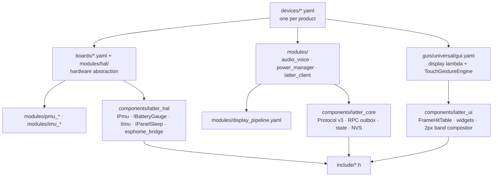

# Architecture

## Layers



A device config is just a list of packages plus the compiled SDK components:

```yaml
# devices/pocket-assistant.yaml (abridged)
external_components:
  - source: { type: git, url: https://github.com/slampton/esphome-latter-core, ref: main }
    components: [latter_hal, latter_core, latter_ui, latter_beacon]
    refresh: 0s

latter_core:

packages:
  hal:                !include ../boards/waveshare_s3_175c.yaml
  latter_audio_voice: !include ../modules/audio_voice.yaml
  latter_power:       !include ../modules/power_manager.yaml
  latter_client:      !include ../modules/latter_client.yaml
  latter_gui:         !include ../guis/universal/gui.yaml
```

Device files also define the parts that differ per product: the `wifi` id, the `ble_ctrl` presence beacon (`latter_beacon`: raw HCI with no host stack, over VHCI on an on-chip controller or over esp_hosted on the P4) and its iBeacon minor, the update source, and default substitutions (power profile, clock face, font sizes).

---

## Directory map

### `boards/`: hardware abstraction (one file per board)
A board file defines:
- **Hardware:** the display, touchscreen, I2C/SPI buses, I2S, and audio codecs.
- **Modules:** which PMU and IMU modules to include.
- **Build settings:** the `LATTER_*` capability flags and sdkconfig options.
- **HAL scripts:** the scripts the core calls, such as `hal_set_dac_mute` and `hal_enter_hardware_hibernate`.

→ [Porting hardware](porting-hardware.md)

### `modules/`: the core

| File | Role |
| :--- | :--- |
| `latter_client.yaml` | The Latter protocol client. Covers boot sequence, Native API actions (`latter_push_v3`, `set_browse_slots`, `set_area_slots`, `show_notification`, `latter_set_beacon_uuid`, `latter_factory_reset`), the diagnostic `System: RPC Outbox` (`latter_rpc_outbox`), global state, user-facing selects, switches, and numbers, the input router (`ui_input_event`), theme and brightness, and both OTA platforms (`http_request` pull-OTA and `esphome` `id: ota_esphome` Noise push-OTA secured by `api.encryption`, locked to `Encryption: required` when Device Builder configs extend `ota_esphome` with `encryption:`). Includes `display_pipeline.yaml`. |
| `display_pipeline.yaml` | `http_request`, Sendspin album art, 3 `online_image` slots (artwork, wallpaper, camera; JPEG decoded to RGB565 at screen size), backlight output with a gamma curve, and the Display light |
| `audio_voice.yaml` | Mixer (no on-device resampling: every source arrives at the board's output rate), Sendspin media source, media player, micro_wake_word, voice_assistant, the internal sound player for alarms, chimes and game sounds (WAVs rendered per rate by `tools/gen_sounds.py`), plus the voice and TTS lifecycle scripts |
| `power_manager.yaml` | The power state machine (active, screensaver, screen off, hibernate), sleep and wake selects, 1 s and 50 ms supervisors, hibernate sequencing, and script `apply_power_policy`, the single owner of every power actuator (Wi-Fi modem sleep, off-site scan backoff, the BLE beacon, the IMU mode, tick gating, battery polling, the light-sleep awake lock and wake pins) |
| `hal/chip_esp32s3.yaml`, `hal/chip_esp32p4.yaml`, `hal/audio_es8311_duplex.yaml` | Shared chip `sdkconfig_options`, light-sleep / P4 DFS setup, and full-duplex 48 kHz ES8311 + resampler microphone blocks included by `boards/*.yaml` |
| `pmu_axp2101.yaml` / `pmu_none.yaml` | Battery, USB, and crown-button handling, or stubs for mains-powered boards |
| `imu_qmi8658.yaml` / `imu_none.yaml` | Accelerometer, tilt, and shake detection, or stubs that return constants |
| `base.yaml` | Minimal identity, time sync, `latter_ping`, `latter_push_v3`, `System: Hardware Manifest`, and `System: RPC Outbox`, for headless nodes |
| `area_control.yaml` | Area context handling plus area-action scripts, for headless nodes |
| `display_ui.yaml` | Convenience umbrella that bundles `latter_client.yaml` and the universal GUI. Used by `examples/custom_display_template.yaml`. |

### `guis/universal/gui.yaml`: the GUI
Fonts, the color palette, the `display:` render lambda (an `!extend` of `disp1` calling `latter_ui::render_system_takeovers(...)` and latching `DirtyBandTracker`'s `2px` horizontal dirty bands), and `touchscreen:` forwarding into the compiled `TouchGestureEngine` (`touch_handlers.yaml` is retired). It defines no API. Everything it needs comes from `latter_client.yaml` and `components/latter_ui/`. → [Building a GUI](building-a-gui.md)

### `include/` & `components/`: 3-component compiled C++20 SDK

| Component / Header | Contents |
| :--- | :--- |
| `components/latter_hal/` + `hal_types.h`, `esphome_bridge.h` | Compiled C++20 HAL interfaces (`IPmu`, `IBatteryGauge`, `IImu`, `IPanelSleep`, `IAudioControl`) with default no-ops (`pmu_axp2101.cpp`, `battery_model.cpp`, `imu_qmi8658.cpp`, `audio_es8311.cpp`, `panel_power.cpp`, `power_pm.cpp`), plus `esphome_bridge.cpp` isolating `BridgeRob<>` accessors (`VoiceAssistant` abort/API-release, `MipiDsi::buffer_`) and `__wrap_*` symbols in a single TU |
| `components/latter_core/` + `latter_protocol.h`, `latter_state.h`, `latter_rpc.h`, `latter_prof.h` | Protocol v3 unpackers, typed domain state, `latter_rpc::emit` outbox framing, tiered NVS (`latter_cfg`), link report counters (`hal_link_report.h`), and main-loop wake probe. Supports `latter_core: gui: "none"` for zero-UI headless nodes |
| `components/latter_ui/` + `ui_hit_table.h`, `ui_gesture_engine.h`, `ui_widgets.h`, `ui_icons.h`, `ui_compositor.h` | Co-located `FrameHitTable` (`hit_table.cpp`), compiled `TouchGestureEngine` (`gesture_engine.cpp`), shared frosted-glass widgets including `ui::pin_pad_modal` (`ui_widgets.cpp`), `render_system_takeovers(...)`, and `DirtyBandTracker` `2px` horizontal-band dirty flush (`ui_compositor.cpp`) |
| `ui_core.h`, `ui_layout.h`, `ui_touch_router.h` | `LATTER_*` defaults, scaling (`scale_*`, `scale_w`, `safe_span`), trig/chord LUTs, row-major `fast_*` primitives, `UiLayout` anchors and mm gesture constants, `TouchRouter`, OTA helpers |
| `ui_clock_home.h`, `ui_music.h`, `ui_area_home_hub.h`, `ui_remote.h`, `ui_weather_sky.h`, `ui_tools.h`, `ui_games.h`, `ui_ambient_va.h`, `ui_system.h` | Domain renderers (with game and tool state structs placed in PSRAM BSS via `LATTER_PSRAM_BSS`) |
| `va_cancel_helper.h`, `audio_router.h` | Voice session teardown and wake-word picker, echo meter (`std::atomic<bool>` gated), loudness model, codec standby |
| `hal_imu_qmi8658.h`, `hal_power_pm.h`, `hal_battery.h` | Header declarations backing the compiled `latter_hal` implementations |

### `examples/`
| File | What it shows |
| :--- | :--- |
| `minimal_headless_companion.yaml` | A bare ESP32-S3 dev board with `base.yaml` and `area_control.yaml`. No display. |
| `custom_display_template.yaml` | A complete 480×480 board HAL with stub HAL scripts, running the full core and universal GUI. Start here when porting. |

### `manifests/` and `index.html`
The ESP Web Tools installer page and per-device manifests. The release workflow rebuilds the manifests with real checksums when it publishes.

---

## Battery power and light sleep

The ESP32-S3 battery boards declare ESPHome's `power_management:` (`modules/hal/chip_esp32s3.yaml`: `enable_light_sleep: true`, 240 MHz maximum, 40 MHz minimum). ESP-IDF then enters automatic light sleep whenever no task is runnable and no power-management lock is held (`~5–8 mA` on home Wi-Fi, `~2–4 mA` off-site). Latter coordinates everything in [`components/latter_hal/power_pm.cpp`](../components/latter_hal/power_pm.cpp) (`include/hal_power_pm.h`), driven by script `apply_power_policy`:

- **Awake lock.** Held whenever the screen is on or showing a screensaver, the device is docked, audio, wake word, a voice turn, OTA, a game, a ringing alarm or timer, Find My, a notification, or a doorbell call is active. It is released only in screen-off quiet on battery.
- **Wake pins & `5,000 ms` quiet loop.** While the lock is released, the PWR key, the action button, the touch interrupt (in low-power gesture/monitor mode when tap to wake works on battery) and the IMU INT1 (while wake-on-motion is armed) wake the chip from light sleep and call `esphome::App.wake_loop_threadsafe()`, allowing the main loop interval to stretch to **5,000 ms** while battery PMU polling stretches to **60 s** and `stall_guard_task` suspends.
- **`WIFI_PS_MAX_MODEM` & weak-link hysteresis.** Screen-off quiet uses `WIFI_PS_MAX_MODEM` (`listen_interval = 3`), keeping the Home Assistant API link up while holding the awake lock only when smoothed RSSI drops below **-75 dBm** (`wlk` in System: Link Report).
- **Smart off-site radio sleep.** When away from known Wi-Fi (`!wifi_connected`), `ha_link_settling` caps at 30 s, Wi-Fi scans back off exponentially (`15 s -> 60 s -> 300 s`, resetting immediately on any wake input), and `latter_beacon` pauses completely.
- **ESP32-P4 power.** Both P4 boards enable dynamic frequency scaling down to `40 MHz` (`modules/hal/chip_esp32p4.yaml`, `enable_light_sleep: false`). On `Remote Assistant` (`waveshare_p4_35`), where `K1` (`GPIO49`) is not an LP deep-sleep wake pin (`!LATTER_PWR_KEY_DEEP_SLEEP_WAKE`), battery hibernate powers off the AXP2101 cleanly (woken by `K1`), while scheduled alarms run whenever USB-docked.

## Build and release

- **CI** ([`validate.yml`](../.github/workflows/validate.yml)) runs on every push and PR: `tools/verify_core.py`, `tools/gen_protocol.py --check`, `tools/check_boards.py --release --check-docs`, `tools/new_board.py --bringup --check`, `tools/gen_sounds.py --check`, C++20 host unit tests, `esphome config` across both examples and all five device configs, and full 5-device firmware compilation on `dev` before fast-forwarding `main`.
- **Release** ([`release.yml`](../.github/workflows/release.yml)) runs on a `v*` tag:
  1. Compiles all five devices with the `esphome/esphome:2026.11.0b3` container.
  2. Writes manifests with each OTA image's MD5.
  3. Publishes the binaries, manifests, and installer page to GitHub Pages.
- **Device configs pull `latter_core` and the packages from `main`.** A build always uses the current `main`, even when it's triggered from a tag.

## Requirements for building

- **ESPHome:** 2026.11.0b3 or newer (Noise-encrypted `esphome` OTA sharing `api.encryption`, esp_hosted 3.1.0 on the P4 boards, `micro_wake_word` `prefer_internal_ram`, and the logger boot-log replay). `min_version` is set in the device configs, and `va_cancel_helper.h` enforces the same version with a `static_assert`.
- **Framework:** ESP-IDF, with C++20. The default for ESPHome 2026.11 (ESP-IDF 5.5.6) is sufficient.
- **PSRAM:** required on every board.
- **Compiler settings:** `CONFIG_COMPILER_OPTIMIZATION_PERF` (`-O2`) and `CONFIG_SPIRAM_MALLOC_ALWAYSINTERNAL=256` on every board.
